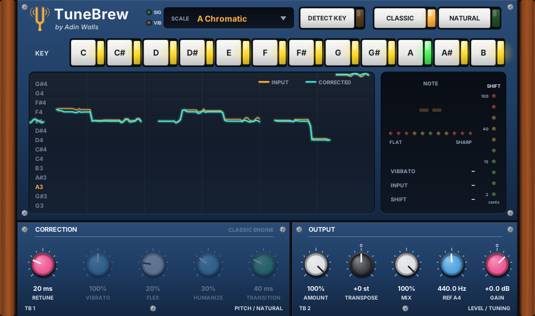

# TuneBrew Autotune

*by Adin Walls*

Real-time vocal pitch correction for Linux. Tune hard and still sound human: it keeps the singer's vibrato even at 0 ms retune, detects the song's key for you, and has a classic hard-tune mode for the robot effect.

**Formats:** LV2, VST3, CLAP and VST2 (64-bit Linux). Works in REAPER, Ardour, Harrison Mixbus, Bitwig Studio, Carla and other Linux DAWs.



---

## Install: step by step

### What you need

- 64-bit Linux with **glibc 2.35 or newer**: Ubuntu / Pop!_OS / Linux Mint 22.04+, Fedora 36+, Debian 12+, Arch, Manjaro.
- A Linux DAW that loads LV2, VST3 or CLAP plugins.

### Option 1: download the ready-made plugin (easiest)

1. Go to the **[Releases page](https://github.com/adinwalls/tunebrew/releases/latest)** and download `TuneBrew-<version>-linux-x86_64.tar.gz`.
2. Open a terminal and go to your Downloads folder:
   ```bash
   cd ~/Downloads
   ```
3. Unpack it:
   ```bash
   tar xzf TuneBrew-*-linux-x86_64.tar.gz
   ```
4. Go into the folder and run the installer:
   ```bash
   cd TuneBrew-*-linux-x86_64
   ./install.sh
   ```
   It copies the plugin into your home folder (`~/.lv2`, `~/.vst3`, `~/.clap`, `~/.vst`), so no `sudo` is needed.
5. Open your DAW and **rescan plugins** (see [Finding it in your DAW](#finding-it-in-your-daw)).
6. Add **TuneBrew Autotune** to your vocal track. Done!

### Option 2: build it from source

1. Install the build tools.

   Ubuntu / Pop!_OS / Mint / Debian:
   ```bash
   sudo apt install git build-essential pkg-config libcairo2-dev libx11-dev libxext-dev
   ```
   Fedora:
   ```bash
   sudo dnf install git gcc-c++ make pkgconf cairo-devel libX11-devel libXext-devel
   ```
   Arch / Manjaro:
   ```bash
   sudo pacman -S --needed git base-devel cairo libx11 libxext
   ```
2. Download the source, including the DPF framework it's built on:
   ```bash
   git clone --recursive https://github.com/adinwalls/tunebrew.git
   cd tunebrew
   ```
3. Build and install:
   ```bash
   ./install.sh
   ```
4. Rescan plugins in your DAW and add **TuneBrew Autotune** to your vocal track.

To update later: `git pull && git submodule update --init --recursive && ./install.sh --rebuild`

### Finding it in your DAW

Menu names vary a little between versions.

- **REAPER:** *Options → Preferences → Plug-ins → VST* (or *CLAP*), then **Re-scan**. Use the CLAP or VST3 version.
- **Ardour / Harrison Mixbus:** LV2 plugins are found on start-up. If it's missing, open *Window → Plugin Manager* and choose **Re-scan**.
- **Bitwig Studio:** *Settings → Locations → Plug-ins*: make sure your user CLAP/VST3 folders are enabled, then rescan.
- **Carla:** *Add Plugin → Refresh*.

The plugin shows up as **TuneBrew Autotune** (maker: Adin Walls).

### Uninstall

```bash
./uninstall.sh
```
Or delete `~/.lv2/TuneBrew.lv2`, `~/.vst3/TuneBrew.vst3`, `~/.clap/TuneBrew.clap` and `~/.vst/TuneBrew-vst.so`.

---

## Quick start

1. Put TuneBrew **first** on the lead vocal track, before compression, EQ, reverb or delay.
2. Press **DETECT KEY**, play 15–30 seconds of the vocal, then press **APPLY**. Or click the key's note and choose a scale yourself.
3. Pick a style:
   - **Natural pop vocal:** NATURAL, Retune 10–20 ms. The defaults are a good start.
   - **Aggressive but human:** NATURAL, Retune 0 ms, Flex 0, Humanize 0.
   - **T-Pain / robot:** CLASSIC, Retune 0 ms.

Example audio is in [`demo/`](demo). Compare `vibrato_vocal_hardtune_CLASSIC.wav` with `vibrato_vocal_hardtune_NATURAL.wav`.

## What it does

- **Natural mode (default):** tunes hard but still sounds human.
  - **Vibrato** (0–200%): the singer's vibrato is detected and kept even at 0 ms retune, because only the note centre is corrected. 100% keeps it untouched, 0% flattens it and 200% doubles it.
  - **Flex** (%): only corrects notes sung near the target, so deliberate bends and blue notes pass through.
  - **Humanize** (%): short notes snap; long held notes are corrected more gently so they keep their life.
  - **Transition** (ms): note attacks, scoops into notes and slides between notes are let through instead of being stair-stepped.
- **Classic mode:** the plain hard-tune sound, with the Natural knobs dimmed and bypassed.
- **Detect Key:** press it and play 15–30 s of the vocal. It shows the key with a confidence meter, the runner-up key, and the recording's tuning offset. **Apply** sets the Key, the Scale and Reference A4 in one click.
- **Live pitch graph:** what was sung (amber) against what comes out (teal), plus a note readout, a flat/sharp LED meter, a correction LED ladder and vibrato depth.

## The editor

- **Key strip:** click a note to set the key. In-scale notes are lit and the note being corrected to is outlined.
- **Scale menu:** click it or scroll over it.
- **Knobs:** drag, hold **Shift** for fine control, scroll to nudge, **double-click** to reset.
- **Resizing:** the window keeps its aspect ratio and is HiDPI aware.

## Controls

| Control | What it does |
|---|---|
| **Key / Scale** | Notes it snaps to. *Chromatic* = nearest semitone |
| **Classic / Natural** | Mode, see above |
| **Retune** (ms) | **0** = instant. **10–30** = tight pop. **40–80** = soft |
| **Vibrato / Flex / Humanize / Transition** | Natural-mode controls, see above |
| **Amount** (%) | How far toward the target note to pull |
| **Transpose** (st) | Shift ±12 semitones (formants preserved) |
| **Ref A4** (Hz) | Tuning reference (Detect Key can set it) |
| **Mix / Gain** | Dry/wet and output level |

### Starting points

- **"Natural" pop vocal:** Natural, Retune 10–20, Vibrato 100, Flex 20, Humanize 30, Transition 40.
- **Aggressive but human (modern rap/pop):** Natural, Retune 0, Vibrato 100, Flex 0, Humanize 0, Transition 20.
- **T-Pain / robot:** Classic, Retune 0.
- **Transparent touch-up:** Natural, Retune 40, Amount 80, Humanize 60.

## Tips

- It needs a clean lead vocal (no backing vocals or instrument bleed), and works best first in the chain.
- Latency is ~49 ms at 48 kHz. It's reported to the host, so playback is compensated automatically. If you hear lag while tracking, monitor dry and add the plugin afterwards.
- Pick the song's actual key/scale. Chromatic works for anything, but it'll also "correct" deliberate blue notes.
- Tracks down to 70 Hz (deep bass voices) and up to 1.1 kHz.

## How it works

- **Detection:** YIN on a 1 kHz low-passed, decimated signal, with a median filter against octave jumps and a level gate. Pitch is analysed every ~5 ms and interpolated per pitch period.
- **Targeting:** key/scale quantiser with hysteresis, so it won't flip between notes.
- **Vibrato separation:** the pitch's turning points are tracked. A regular 3–9 Hz swing of similar size is classed as vibrato, its centre becomes the note being corrected, and the swing is added back (scaled by the Vibrato knob).
- **Key detection:** time spent on each pitch is counted in 10-cent bins, ignoring slides. A circular mean gives the tuning offset, the bins fold into 12 pitch classes, and those are correlated against Krumhansl-Kessler major/minor profiles. Tested on 24 keys × 2 seed sets with random ±45-cent tuning: 47 of 48 correct, and the one miss reported 6% confidence.
- **Retune:** the correction offset is smoothed with a one-pole filter. Fast settings flatten vibrato; slow settings let it through.
- **Shifting:** TD-PSOLA. Pitch marks are tracked cycle-to-cycle by waveform similarity, so grains always overlap in phase: no phasiness or "underwater" smear. With zero correction the output is a bit-exact copy of the input, and formants are preserved.

Measured on synthetic vocals with ±40-cent detuning and vibrato: mean error after hard-tune is **0.2–0.5 cents** (from ~23 cents). Hard-tuned output sits within 7.7 dB log-spectral distance of a perfect-pitch reference (v1.1: 11.8 dB). Pass-through at zero correction measures 50+ dB SNR. Tested at 44.1, 48, 88.2 and 96 kHz. CPU is around 2% of one core, stereo, at 48 kHz.

## Build details

`make` builds every format into `bin/`, and `make install` (or `./install.sh`) copies them to your home plugin folders.

Built on [DPF](https://github.com/DISTRHO/DPF) (ISC licence), included as a git submodule in `dpf/`. The DSP lives in `src/TuneEngine.hpp`, a header-only engine you can reuse. The editor is `src/TuneView.hpp`, plain Cairo with no framework dependency. Offline test scripts are in `test/`.

## Changelog

- **1.4.3** Stronger lamp and LED glow.
- **1.4.2** Plastic push buttons with glowing side lamps (key, mode, detect, apply/stop).
- **1.4.1** Tuning-fork logo.
- **1.4** New rack-style editor: wooden cheeks, navy module faceplates, coloured knob caps with printed scales, push buttons, LED tuning meter, LED shift ladder and SIG/VIB status LEDs.
- **1.3** Natural mode (vibrato kept at hard tune, Flex, Humanize, Transition), Classic/Natural switch, Detect Key with tuning detection, larger editor.
- **1.2** Fixed the "underwater"/phasey sound. Pitch marks are now waveform-locked, interpolation is cubic and the timing offset is stable. Latency rose from 36 to 49 ms (compensated by the host).
- **1.1** Custom editor: pitch graph, key strip, scale menu, tuning meter.
- **1.0** First release.

## Licence

TuneBrew is free software under the **GNU General Public License v3.0**; see [LICENSE](LICENSE).
The DPF framework is ISC-licensed. The speech in `demo/` comes from a public-domain LibriVox recording (via the librosa example data); the other demo vocals are synthesised.
