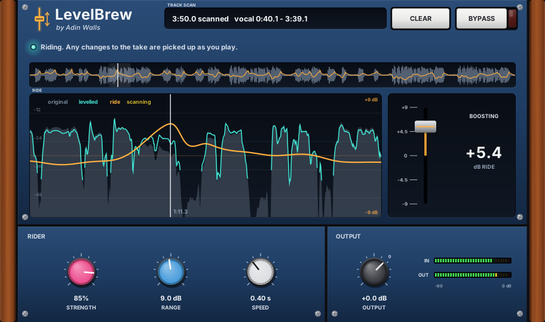

# Adin Brew

*Vocal plugins for Linux by Adin Walls*

## The plugins

### [TuneBrew Autotune](plugins/TuneBrew/README.md)

[](plugins/TuneBrew/README.md)

Real-time pitch correction that tunes hard and still sounds human. It keeps vibrato at 0 ms retune, detects the key for you, and has a classic hard-tune mode for the robot effect.
**[Read the TuneBrew guide →](plugins/TuneBrew/README.md)**

### [LevelBrew Vocal Rider](plugins/LevelBrew/README.md)

[](plugins/LevelBrew/README.md)

Automatic level riding for a recorded vocal. It scans the vocal on its own track: play it once, or export it to scan it in seconds. Then it rides the level smoothly on every playback while you watch the fader move. Edits to the take are picked up as you play.
**[Read the LevelBrew guide →](plugins/LevelBrew/README.md)**

**Formats:** LV2, VST3 and VST2 (64-bit Linux), plus CLAP for TuneBrew. They work in Harrison Mixbus, Ardour, REAPER, Bitwig Studio, Carla and other Linux DAWs.

---

## Install: step by step

### What you need

- 64-bit Linux with **glibc 2.35 or newer**: Ubuntu / Pop!_OS / Linux Mint 22.04+, Fedora 36+, Debian 12+, Arch, Manjaro.
- A Linux DAW that loads LV2, VST3 or CLAP plugins.

### Option 1: download the ready-made plugins (easiest)

1. Download **[adin-brew-linux-x86_64.tar.gz](https://github.com/adinwalls/adin-brew/raw/main/dist/adin-brew-linux-x86_64.tar.gz)** (about 2 MB). It'll go to your Downloads folder.
   Or download it from a terminal:
   ```bash
   wget -P ~/Downloads https://github.com/adinwalls/adin-brew/raw/main/dist/adin-brew-linux-x86_64.tar.gz
   ```
2. Open a terminal and go to your Downloads folder:
   ```bash
   cd ~/Downloads
   ```
3. Unpack it:
   ```bash
   tar xzf adin-brew-linux-x86_64.tar.gz
   ```
4. Go into the folder and run the installer:
   ```bash
   cd adin-brew-linux-x86_64
   ./install.sh
   ```
   It copies both plugins into your home folder (`~/.lv2`, `~/.vst3`, `~/.clap`, `~/.vst`), so no `sudo` is needed.
5. Open your DAW and **rescan plugins** (see [Finding them in your DAW](#finding-them-in-your-daw)).
6. Add **TuneBrew Autotune** or **LevelBrew Vocal Rider** to your vocal track. Done!

### Option 2: build them from source

1. Install the build tools.

   Ubuntu / Pop!_OS / Mint / Debian:
   ```bash
   sudo apt install git build-essential pkg-config libcairo2-dev libx11-dev libxext-dev
   ```
   Fedora:
   ```bash
   sudo dnf install git gcc-c++ make pkgconf cairo-devel libX11-devel libXext-devel
   ```
   Arch / Manjaro:
   ```bash
   sudo pacman -S --needed git base-devel cairo libx11 libxext
   ```
2. Download the source, including the DPF framework they're built on:
   ```bash
   git clone --recursive https://github.com/adinwalls/adin-brew.git
   cd adin-brew
   ```
3. Build and install:
   ```bash
   ./install.sh
   ```
4. Rescan plugins in your DAW.

To update later: `git pull && git submodule update --init --recursive && ./install.sh --rebuild`

### Finding them in your DAW

Menu names vary a little between versions.

- **Ardour / Harrison Mixbus:** LV2 plugins are found on start-up. If one is missing, open *Window → Plugin Manager* and choose **Re-scan**.
- **REAPER:** *Options → Preferences → Plug-ins → VST* (or *CLAP*), then **Re-scan**. Use the VST3 version (or CLAP for TuneBrew).
- **Bitwig Studio:** *Settings → Locations → Plug-ins*: make sure your user VST3/CLAP folders are enabled, then rescan.
- **Carla:** *Add Plugin → Refresh*.

They show up as **TuneBrew Autotune** and **LevelBrew Vocal Rider** (maker: Adin Walls).

### Uninstall

```bash
./uninstall.sh
```
Or delete `TuneBrew.*` / `LevelBrew.*` from `~/.lv2`, `~/.vst3`, `~/.clap` and `~/.vst`.

---

---

## Build details

`make` builds every format into `bin/`, and `make install` (or `./install.sh`) copies them to your home plugin folders.

Built on [DPF](https://github.com/DISTRHO/DPF) (ISC licence), included as a git submodule in `dpf/`.

- **TuneBrew:** the DSP lives in `src/TuneEngine.hpp`, a header-only engine you can reuse, and the editor is `src/TuneView.hpp`.
- **LevelBrew:** the track scanner, ride curve and player live in `src/LevelEngine.hpp`, and the editor is `src/LevelView.hpp`.

Both editors are plain Cairo with no framework dependency. Test programs are in `test/`. For example, `test/level_workflow.cpp` simulates scanning, riding and editing a take on the engine, and `test/level_vsthost.cpp` drives the LevelBrew binary like a DAW does.

## Changelog

See each plugin's guide: [TuneBrew](plugins/TuneBrew/README.md#changelog) · [LevelBrew](plugins/LevelBrew/README.md#changelog)

## Licence

TuneBrew and LevelBrew are free software under the **GNU General Public License v3.0**; see [LICENSE](LICENSE).
The DPF framework is ISC-licensed. The speech in `demo/` comes from a public-domain LibriVox recording (via the librosa example data); the other demo vocals are synthesised.
