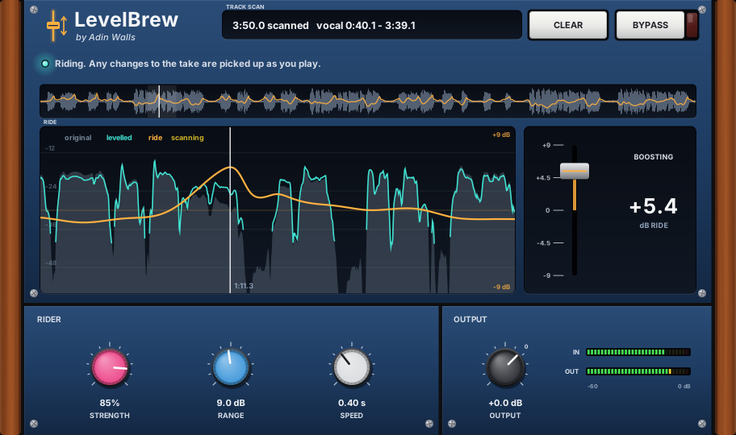

# LevelBrew Vocal Rider

*by Adin Walls*

**Formats:** LV2, VST3 and VST2.

A vocal rider for takes you've already recorded. LevelBrew scans the vocal on the track it's loaded onto, so it knows the whole take in advance and can ride the level smoothly, the way you'd ride a fader by hand. Then, on every playback, you **watch it work**: a scrolling view of the original level, the levelled vocal and the ride curve, plus a fader that moves with the ride.

There are no files to load and nothing to line up. The plugin works from the audio on its own track.

## Quick start

1. Put LevelBrew **first** on the vocal track, before EQ, compression or effects.
2. **Scan the track** by playing the song through once. Or **export / bounce the track**: the DAW runs faster than real time during an export, so the scan only takes a few seconds. During the scan LevelBrew only listens and leaves the sound untouched.
3. Press **play** again. LevelBrew now rides the vocal wherever you play, loop or jump to.
4. Adjust **Strength**, **Range** and **Speed** to taste. The defaults are a moderate, natural ride.

The scan is saved with your session, so next time it rides straight away.

## How it behaves

- **It scans the track it's on.** Plugins can't read a track's audio ahead of time in Mixbus or Ardour; that needs a plugin extension called ARA, which these DAWs don't have. So, like Melodyne without ARA, LevelBrew learns the take by hearing it once. Exporting is the fast way to do that.
- **It keeps up with changes.** Every playback refreshes the scan. If part of the vocal has changed (re-recorded, edited, moved, or a different take comped in), LevelBrew notices within a fraction of a second. It stops riding that part, re-scans it as it plays, and rides it again from the next playback. The rest of the song keeps riding as normal.
- **It rides with the whole take in view.** Because the scan covers the whole song, the ride looks ahead and behind. It starts moving before a loud or quiet phrase arrives, instead of reacting after it.
- **No pumping.** Silences, breaths and "S" sounds are ignored when judging the level, gaps hold the neighbouring gain instead of jumping, and long silences relax back to 0 dB.
- **No latency.** The ride is worked out in advance, so the plugin adds no delay.
- **Smooth hand-overs.** Whenever riding starts or stops (bypass, the edge of a scanned area, a changed section), the ride fades in or out over 300 ms, so there are no clicks.

## Controls

| Control | What it does |
|---|---|
| **Strength** (%) | How much of the level difference to even out. 100% = fully level, 50% = halfway. Default 85% |
| **Range** (dB) | Largest boost or cut it may apply. Default ±9 dB |
| **Speed** (s) | How slowly it moves. Small = follows individual words, large = follows whole phrases. Default 0.4 s |
| **Output** (dB) | Output trim |
| **Bypass** | Compare with the original |
| **CLEAR** | Forget the scan, so the next playback scans the track from scratch. Click twice to confirm |

## The display

- **Status line:** tells you what LevelBrew is doing: waiting for a scan, scanning, riding, or ready.
- **Track scan readout:** how much of the timeline has been scanned and where the vocal sits on it.
- **Overview:** the whole scanned vocal with its ride curve. The shaded area is the part shown in the big graph.
- **Ride graph** (scrolls with playback):
  - **grey:** original level
  - **teal:** levelled vocal
  - **orange:** ride curve
  - **yellow:** a part being scanned on this playback, which rides from the next one
- **Rider fader:** moves with the boost or cut being applied right now.

## Good to know

- **Keep it first in the chain.** LevelBrew judges the level of what reaches it, and it spots changes by comparing what it hears with its scan. Effects before it, or automation that changes what reaches it, would look like changes to the take.
- **Change detection needs a few dB.** A small level tweak of a dB or two isn't treated as a change. If you want LevelBrew to start over, press **CLEAR** and play or export once.
- **A changed section can resume early in a long gap.** If an edited section contains a gap of more than 2 s with no singing, riding can resume briefly in that gap before the change is detected again. It's fully sorted from the next playback.
- **Sample rate:** if you change the session's sample rate, LevelBrew scans again.
- **No CLAP version.** DPF passes CLAP hosts a steady sample counter instead of the song position, which LevelBrew needs. Use LV2 or VST3.

## How it works

- **Scanning:** while the transport rolls, the plugin hands its input to a background thread, which stores compact level data for every 10 ms of the timeline: a 40 ms window level high-passed at 90 Hz so rumble doesn't count, a 10 ms level, the peak, and whether it's an "S" sound (energy above 5 kHz).
- **Singing detection:** frames within 24 dB of the take's loud passages count as singing, with a 70 ms majority filter against flicker. Digitally silent stretches (no region) are ignored.
- **Ride curve:** the local loudness is an energy average over nearby singing only (Gaussian, width set by Speed), compared to the take's own median level, scaled by Strength, limited by Range and smoothed again over ~120 ms.
- **Change detection:** when at least 20 of the last 30 hops (10 ms each) differ from the stored scan by more than 3 dB, that stretch is re-scanned. Riding pauses from there until 2 s after the changes stop.
- **Session state:** about 6 bytes per 10 ms, roughly 190 KB for a four-minute song.

In testing with a real 3:50 vocal, the phrase-to-phrase level swing went from 2.3 dB to 0.9 dB at the default settings, using −4 to +6 dB of gain.

An end-to-end test drives the plugin binary like a DAW (`test/level_vsthost.cpp`):
- **Scanning:** a scan at export speed left the audio untouched.
- **Riding:** the next playback rode 97% of the singing, within 0.01 dB of the planned ride.
- **Edits:** an edited section was re-scanned and ridden correctly on the following pass.
- **Sessions:** a reopened session rode straight away.

## Changelog

- **2.0** Scans the audio on its own track; no more loading a file or syncing to the timeline. Change detection, scan saved with the session, CLEAR button.
- **1.0** First release (loaded the vocal from a WAV file).

---

Part of **[Adin Brew](../../README.md)**. Installing, finding the plugin in your DAW and uninstalling are covered on the [main page](../../README.md#install-step-by-step).
