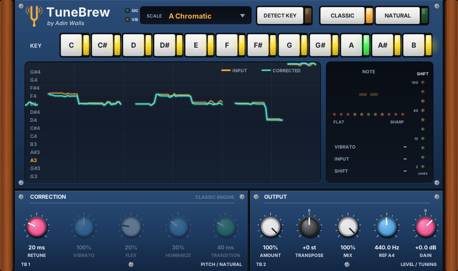
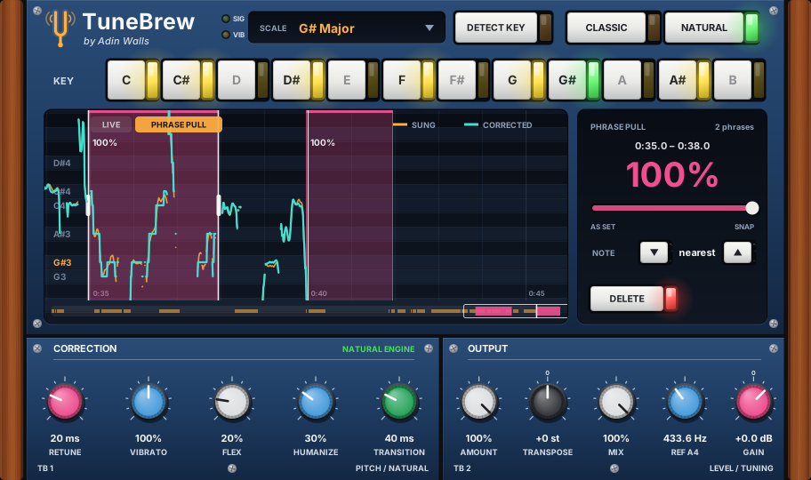

# TuneBrew Autotune

*by Adin Walls*

Real-time vocal pitch correction for Linux. Tune hard and still sound human: it keeps the singer's vibrato even at 0 ms retune, detects the song's key for you, and has a classic hard-tune mode for the robot effect.

**Formats:** LV2, VST3, CLAP and VST2.

## Quick start

1. Put TuneBrew **first** on the lead vocal track, before compression, EQ, reverb or delay.
2. Press **DETECT KEY**, play 15–30 seconds of the vocal, then press **APPLY**. Or click the key's note and choose a scale yourself.
3. Pick a style:
   - **Natural pop vocal:** NATURAL, Retune 10–20 ms. The defaults are a good start.
   - **Aggressive but human:** NATURAL, Retune 0 ms, Flex 0, Humanize 0.
   - **T-Pain / robot:** CLASSIC, Retune 0 ms.

If a phrase still isn't in tune, mark it with **Phrase Pull** (below) instead of re-singing it.

Example audio is in [`demo/`](../../demo). Compare `vibrato_vocal_hardtune_CLASSIC.wav` with `vibrato_vocal_hardtune_NATURAL.wav`.

## Phrase Pull: fix one phrase without touching the rest

The knobs set how the whole song is tuned. Phrase Pull lets you mark the phrases that need more, and pull only those harder into key.

1. Click the **PHRASE PULL** tab above the graph.
2. Play the song once. The vocal's pitch is drawn along the song as it plays (amber = sung, teal = corrected). It's saved with the session, so you only do this once per take.
3. Stop, then **drag across a phrase** in the graph. It's marked and set to 100% pull.
4. Play it back. Adjust with the panel on the right:
   - **Pull slider:** 100% snaps the phrase fully onto the scale: Flex, Humanize, Transition and Retune are overridden inside the phrase. 0% leaves it on the knob settings. Vibrato is still kept in Natural mode.
   - **Note ▼ ▲:** if a note was sung closer to the wrong pitch, move the target one scale step down or up for that phrase. Mark just that note.
   - **Delete** removes the phrase. With nothing selected, **Clear all** removes every phrase.

Moving around: scroll in the graph, or drag the strip at the bottom, which shows the whole song. Drag a phrase's edges to resize it. Scroll on a phrase to change its pull. Up to 64 phrases, saved with the session.

Phrase Pull needs the song position from the DAW, so it works in the LV2, VST3 and VST2 versions, not CLAP. If you re-record or move the vocal, play the changed part once and the picture updates.

## Getting the tuned vocal out of the DAW

Plugins don't change the recording on disk, so the WAV in the session's audio folder is still the raw take. To use the tuned vocal elsewhere, export it with the plugin active: in Mixbus or Ardour use *Session → Export → Stem Export*, tick the vocal track and make sure track processing is applied.

## What it does

- **Natural mode (default):** tunes hard but still sounds human.
  - **Vibrato** (0–200%): the singer's vibrato is detected and kept even at 0 ms retune, because only the note centre is corrected. 100% keeps it untouched, 0% flattens it and 200% doubles it.
  - **Flex** (%): only corrects notes sung near the target, so deliberate bends and blue notes pass through.
  - **Humanize** (%): short notes snap; long held notes are corrected more gently so they keep their life.
  - **Transition** (ms): note attacks, scoops into notes and slides between notes are let through instead of being stair-stepped.
- **Classic mode:** the plain hard-tune sound, with the Natural knobs dimmed and bypassed.
- **Detect Key:** press it and play 15–30 s of the vocal. It shows the key with a confidence meter, the runner-up key, and the recording's tuning offset. **Apply** sets the Key, the Scale and Reference A4 in one click.
- **Phrase Pull:** mark phrases on a picture of the take and pull just those harder into key, or move a wrong note. See above.
- **Live pitch graph:** what was sung (amber) against what comes out (teal), plus a note readout, a flat/sharp LED meter, a correction LED ladder and vibrato depth.

## The editor

- **Key strip:** click a note to set the key. In-scale notes are lit and the note being corrected to is outlined.
- **Scale menu:** click it or scroll over it.
- **Knobs:** drag, hold **Shift** for fine control, scroll to nudge, **double-click** to reset.
- **Resizing:** the window keeps its aspect ratio and is HiDPI aware.

## Controls

| Control | What it does |
|---|---|
| **Key / Scale** | Notes it snaps to. *Chromatic* = nearest semitone |
| **Classic / Natural** | Mode, see above |
| **Retune** (ms) | **0** = instant. **10–30** = tight pop. **40–80** = soft |
| **Vibrato / Flex / Humanize / Transition** | Natural-mode controls, see above |
| **Amount** (%) | How far toward the target note to pull |
| **Transpose** (st) | Shift ±12 semitones (formants preserved) |
| **Ref A4** (Hz) | Tuning reference (Detect Key can set it) |
| **Mix / Gain** | Dry/wet and output level |

### Starting points

- **"Natural" pop vocal:** Natural, Retune 10–20, Vibrato 100, Flex 20, Humanize 30, Transition 40.
- **Aggressive but human (modern rap/pop):** Natural, Retune 0, Vibrato 100, Flex 0, Humanize 0, Transition 20.
- **Firmly in key, whole song:** the same with Amount 100 and Mix 100. Flex and Humanize are what make the default feel gentle: Flex leaves notes alone when they are far from the target.
- **T-Pain / robot:** Classic, Retune 0.
- **Transparent touch-up:** Natural, Retune 40, Amount 80, Humanize 60.

## Tips

- It needs a clean lead vocal (no backing vocals or instrument bleed), and works best first in the chain.
- Latency is ~49 ms at 48 kHz. It's reported to the host, so playback is compensated automatically. If you hear lag while tracking, monitor dry and add the plugin afterwards.
- Pick the song's actual key/scale. Chromatic works for anything, but it'll also "correct" deliberate blue notes.
- Tracks down to 70 Hz (deep bass voices) and up to 1.1 kHz.

## How it works

- **Detection:** YIN on a 1 kHz low-passed, decimated signal, with a median filter against octave jumps and a level gate. Pitch is analysed every ~5 ms and interpolated per pitch period.
- **Targeting:** key/scale quantiser with hysteresis, so it won't flip between notes.
- **Vibrato separation:** the pitch's turning points are tracked. A regular 3–9 Hz swing of similar size is classed as vibrato, its centre becomes the note being corrected, and the swing is added back (scaled by the Vibrato knob).
- **Key detection:** time spent on each pitch is counted in 10-cent bins, ignoring slides. A circular mean gives the tuning offset, the bins fold into 12 pitch classes, and those are correlated against Krumhansl-Kessler major/minor profiles. Tested on 24 keys × 2 seed sets with random ±45-cent tuning: 47 of 48 correct, and the one miss reported 6% confidence.
- **Retune:** the correction offset is smoothed with a one-pole filter. Fast settings flatten vibrato; slow settings let it through.
- **Shifting:** TD-PSOLA. Pitch marks are tracked cycle-to-cycle by waveform similarity, so grains always overlap in phase: no phasiness or "underwater" smear. With zero correction the output is a bit-exact copy of the input, and formants are preserved.

Measured on synthetic vocals with ±40-cent detuning and vibrato: mean error after hard-tune is **0.2–0.5 cents** (from ~23 cents). Hard-tuned output sits within 7.7 dB log-spectral distance of a perfect-pitch reference (v1.1: 11.8 dB). Pass-through at zero correction measures 50+ dB SNR. Tested at 44.1, 48, 88.2 and 96 kHz. CPU is around 0.3% of one core, stereo, at 48 kHz (a 4-minute vocal processes in under a second).

## Changelog

- **1.5** Phrase Pull: a picture of the take along the song, drag across a phrase to pull it harder into key, per-phrase pull amount and note shift, saved with the session. About 6x less CPU in the tuning engine (silence costs nothing, faster pitch search and grain placement). The editor draws about 3.5x faster per picture, at most 30 times a second, and not at all when nothing changes. The LV2 version is now a single file.
- **1.4.3** Stronger lamp and LED glow.
- **1.4.2** Plastic push buttons with glowing side lamps (key, mode, detect, apply/stop).
- **1.4.1** Tuning-fork logo.
- **1.4** New rack-style editor: wooden cheeks, navy module faceplates, coloured knob caps with printed scales, push buttons, LED tuning meter, LED shift ladder and SIG/VIB status LEDs.
- **1.3** Natural mode (vibrato kept at hard tune, Flex, Humanize, Transition), Classic/Natural switch, Detect Key with tuning detection, larger editor.
- **1.2** Fixed the "underwater"/phasey sound. Pitch marks are now waveform-locked, interpolation is cubic and the timing offset is stable. Latency rose from 36 to 49 ms (compensated by the host).
- **1.1** Custom editor: pitch graph, key strip, scale menu, tuning meter.
- **1.0** First release.

---

Part of **[Adin Brew](../../README.md)**. Installing, finding the plugin in your DAW and uninstalling are covered on the [main page](../../README.md#install-step-by-step).
